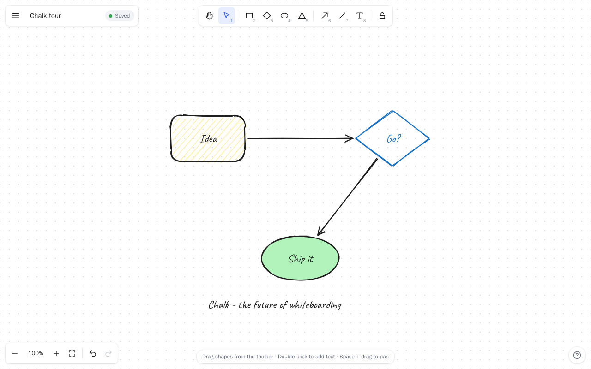

# Chalk

> The future of whiteboarding.

Chalk is a small, readable, MIT-licensed whiteboard in the spirit of Excalidraw. Drag shapes onto an infinite canvas, type text anywhere, and connect boxes with arrows that stay attached when you move them. The rendering, geometry, arrow binding and text editor are our own code (about 11k lines of TypeScript, tests included, plus a small Python API), so you can read the whole engine in an afternoon and bend it to your own ideas.

Everything runs in Docker. Nothing is installed on your machine: no Node, no Python, no npm packages.



## Quick start

You need Docker Desktop (or any Docker with Compose v2). From the repository root:

```sh
docker compose up --build
```

Then open <http://localhost:8080>. The first build takes a few minutes (`npm ci` plus `vite build`); later builds reuse the cache. Add `-d` to run in the background, and use `docker compose down` to stop it. Your boards are kept.

Check that the server is up: <http://localhost:8080/api/health> returns `{"status":"ok"}`.

## Features

- **Shapes:** rectangle (sharp or round), diamond, ellipse and triangle, drawn hand-sketched with [rough.js](https://roughjs.com/). Drag them from the toolbar (a dashed, true-size preview follows the pointer), press a tool key and drag, or press a tool key and click to place one at the default size.
- **Select and edit:** click, Shift+click and marquee selection; hollow shapes are selectable from inside. Move (Shift locks the axis), resize with 8 handles (flip, Shift keeps the aspect, Alt resizes from the center), delete, duplicate (Ctrl+D or Alt+drag), copy/cut/paste, z-order and arrow-key nudging.
- **Text anywhere:** double-click the empty canvas, or use the text tool. Double-click a shape to label it; labels wrap, are centered, and the shape grows to fit. Free text can be turned into a fixed-width wrapping box by dragging its side handle.
- **Arrows that connect:** hover a shape to see the binding target, drag from one shape to another and both ends attach. Arrows follow when shapes move, resize or grow, freeze in place if a shape is deleted, and get their bindings back on undo. Shift snaps to 15 degrees, Ctrl avoids connecting, Alt anchors at the exact point. Arrows can carry labels; the line tool draws plain lines.
- **Style:** stroke and background color (palette or custom), fill style, stroke width and style, sloppiness, edges, opacity, font size and family, text alignment and arrowheads. Styles are sticky: they apply to the selection and become the defaults for the next shape.
- **Infinite canvas:** pan with the wheel, Shift+wheel, Space+drag, middle mouse or the hand tool; zoom with Ctrl+wheel, the buttons or the keys; zoom to fit, zoom to selection, and a "Back to content" button.
- **Undo and redo** for every change, with merged slider and nudge steps.
- **Boards:** many boards, saved automatically to a small SQLite database behind a Python API. The view of each board is remembered. If a board is changed somewhere else you get a conflict banner (Reload or Keep mine), and unsaved work is also backed up in the browser and restored after a crash or a lost connection.
- **Files:** export and import `.chalk.json`, and export a crisp 2x PNG with a white background.

### Keyboard shortcuts

Press `?` in the app for the full list. The essentials:

| Keys | Action |
|---|---|
| `V` / `H` | Select / hand (pan) |
| `R` `D` `O` `5` | Rectangle, diamond, ellipse, triangle (or `2` `3` `4` `5`) |
| `A` / `L` / `T` | Arrow / line / text (or `6` `7` `8`) |
| `Q` | Keep the tool after drawing (lock) |
| Double-click, `Enter` | Edit text or label (double-click on empty canvas: new text) |
| `Esc`, `Ctrl+Enter` | Finish editing / cancel / clear selection |
| `Delete`, `Ctrl+D`, `Alt`+drag | Delete, duplicate, duplicate while moving |
| `Ctrl+C` `Ctrl+X` `Ctrl+V`, `Ctrl+A` | Copy, cut, paste, select all |
| `Ctrl+Z`, `Ctrl+Shift+Z` or `Ctrl+Y` | Undo, redo |
| `Ctrl+]` / `Ctrl+[` (add `Shift`) | Bring forward / send backward (to front / to back) |
| Arrow keys (`Shift`) | Nudge by 1 (10) |
| `Shift` while drawing / `Alt` while drawing | Square or circle / from the center |
| Wheel, `Shift`+wheel, `Space`+drag | Pan |
| `Ctrl`+wheel, `Ctrl`+`=` / `-` / `0` | Zoom at the cursor, zoom in / out / 100% |
| `Shift+1` / `Shift+2` | Zoom to fit everything / to the selection |
| `Ctrl+S` | Save now (autosave runs anyway) |

## Development mode (hot reload)

```sh
docker compose -f compose.dev.yaml up --build
```

Open <http://localhost:5173>. The Vite dev server proxies `/api` to the Python API on <http://localhost:8000>. Saving a file under `frontend/src` hot-reloads the page; saving a file under `backend/app` restarts uvicorn. File watching uses polling, because bind mounts on Windows and WSL2 deliver no change events. Dev data lives in its own volume (`chalk-dev-data`), separate from your real boards. `docker compose -f compose.dev.yaml down` stops it; add `-v` only if you want to wipe the **dev** database.

After changing `frontend/package.json` or its lockfile, rebuild with `docker compose -f compose.dev.yaml up --build -V`.

Docker leaves an empty `frontend/node_modules` folder in the repository as a mount point. That is harmless and git-ignored.

## Running the tests (all in Docker)

Unit tests and the typecheck (sources are mounted read-only, so no rebuild is needed after an edit):

```sh
docker compose -f compose.test.yaml run --rm web-unit                      # tsc --noEmit + vitest
docker compose -f compose.test.yaml run --rm web-unit npx vitest run src/core/binding.test.ts
docker compose -f compose.test.yaml run --rm api-unit                      # pytest
```

End-to-end tests (Playwright in Chromium against a throwaway instance of the production image; it always rebuilds first):

```sh
docker compose -f compose.test.yaml up --build --force-recreate --abort-on-container-exit --exit-code-from e2e app-test e2e
docker compose -f compose.test.yaml down
```

Screenshots of the scenarios land in `e2e/artifacts/screens/`, and a Playwright HTML report with traces of failures in `e2e/artifacts/report/` (both git-ignored). To iterate on a single spec:

```sh
docker compose -f compose.test.yaml up -d --build --force-recreate --wait app-test
docker compose -f compose.test.yaml run --rm --build e2e npx playwright test tests/arrows.spec.ts --retries 0
docker compose -f compose.test.yaml down
```

The test instance has its own database in `/tmp` and never touches your boards.

## Project structure

```
Dockerfile, compose.yaml, compose.dev.yaml, compose.test.yaml   one image, three Compose projects
backend/app/        FastAPI app: models.py (API contract), db.py (SQLite), routes.py, main.py
backend/tests/      pytest
frontend/src/
  types.ts, constants.ts, testids.ts     shared contracts
  core/        pure TypeScript: geometry, arrow binding, scene operations, text layout, serialization
  state/       the store, undo history and the command layer (actions.ts)
  render/      canvas drawing (rough.js), selection overlay, PNG/JSON export
  tools/       one gesture state machine per tool (select, shape, arrow, text, hand)
  input/       pointer router, keyboard shortcuts, clipboard
  persistence/ API client, board lifecycle, autosave and conflict handling, local backup
  ui/          the React chrome (toolbar, style panel, menus, dialogs, text editor)
  testing/     the window.__CHALK__ hook used by the e2e suite
e2e/tests/          Playwright specs, helpers and the shared test ids
docs/HACKING.md     how to extend Chalk (add a shape, a tool, a style, ...)
```

Data flows one way: input becomes a command in `state/actions.ts`, which calls pure functions in `core/`, which return new immutable arrays, which the store publishes to the canvas, the React chrome and autosave. `docs/HACKING.md` has the recipes.

## What is out of scope (and where it would go)

These are deliberate omissions for a first version. Each has a clear seam, so you know where to start.

| Feature | Why it is out | Seam |
|---|---|---|
| Rotation | Multiplies the cost of hit testing, resize, binding and the text overlay. Not requested. | Add `angle` plus `MIGRATIONS[2]`; the geometry functions all take an element. |
| Multi-point, curved or elbow arrows | Straight connectors cover "connect boxes". | `ArrowElement.via?: Point[]`; `resolveArrow` uses the first and last segments. |
| Freehand pen and eraser | Needs perfect-freehand and a new element type. | A new tool file plus a new element type. |
| Groups and frames | Bookkeeping that would bloat the core. | `groupIds`, and selection expansion in `tools/select.ts`. |
| Images and embeds | Needs blob storage. | `/api/files` plus an `image` element. |
| Real-time collaboration, auth | This is a local single-user app. | Per-element version fields, a WebSocket route. |
| SVG export | Needs a second renderer and an embedded font. | `gen.toPaths(drawable)` in `render/export.ts`. |
| Dark mode | Element colors are literal. | CSS tokens plus a color transform in `drawScene`. |
| Grid snapping and alignment guides | Nice to have. | One function applied to the delta in `moveElements`. |
| Touch pinch-zoom, mobile layout, i18n | Desktop first. Pointer events keep basic touch working. | `input/pointer.ts`, `ui/*`. |
| System-clipboard images, copy as PNG | Unavailable on the non-secure e2e origin. | `input/clipboard.ts`. |

## Your data and backups

Boards are stored in SQLite at `/data/chalk.db` inside the container, on the Docker named volume `chalk_chalk-data`. The volume survives `docker compose down`, `docker compose up --build`, restarts and image rebuilds.

- **Back up a board:** Menu, then "Export JSON". The `.chalk.json` file is portable; "Import JSON" puts it on any board in any Chalk. This is the easiest backup and the one to keep before experiments.
- **Never run `docker compose down -v` in this project:** `-v` deletes the volume and with it every board. Plain `docker compose down` is safe.
- **Copy the whole database out of the volume** (no install needed; the app must be running). The database uses SQLite WAL mode, so take the copy with SQLite's backup call rather than copying the file directly:

  ```sh
  docker compose exec app python -c "import sqlite3; s=sqlite3.connect('/data/chalk.db'); d=sqlite3.connect('/tmp/chalk-backup.db'); s.backup(d); d.close()"
  docker compose cp app:/tmp/chalk-backup.db ./chalk-backup.db
  ```

  Backups like this are not committed: `*.db` is git-ignored.
- **OneDrive and similar sync folders:** this repository can live in one, but Docker volumes are not part of the folder, so your boards are never synced or touched by it. Keep the folder set to "Always keep on this device" if you use dev mode, because hot reload needs the files to be present locally. Docker creates an empty `frontend/node_modules` folder here; do not let a sync tool fill it.

## Versions

Exact pins (all licenses are MIT, ISC, BSD, Apache-2.0, or OFL-1.1 for the font):

| Part | Version |
|---|---|
| Node image | `node:24.22.1-trixie-slim` |
| Python image | `python:3.14.9-slim-trixie` (venv at `/opt/venv` inside the image) |
| React, React DOM | 19.3.1 |
| rough.js | 4.6.6 |
| @fontsource/caveat | 5.3.0 |
| Vite / @vitejs/plugin-react | 8.3.5 / 6.1.2 |
| TypeScript | 6.0.3 |
| Vitest | 5.0.5 |
| FastAPI / Pydantic / Uvicorn | 0.161.1 / 2.14.1 / 0.54.0 |
| pytest / httpx2 | 9.1.1 / 2.16.0 |
| Playwright (npm and image) | 1.64.1 / `mcr.microsoft.com/playwright:v1.64.1-noble` |

No fallback pins were needed: every version above works as written.

## License

MIT. Copyright (c) 2026 The Chalk authors. See [LICENSE](LICENSE).
